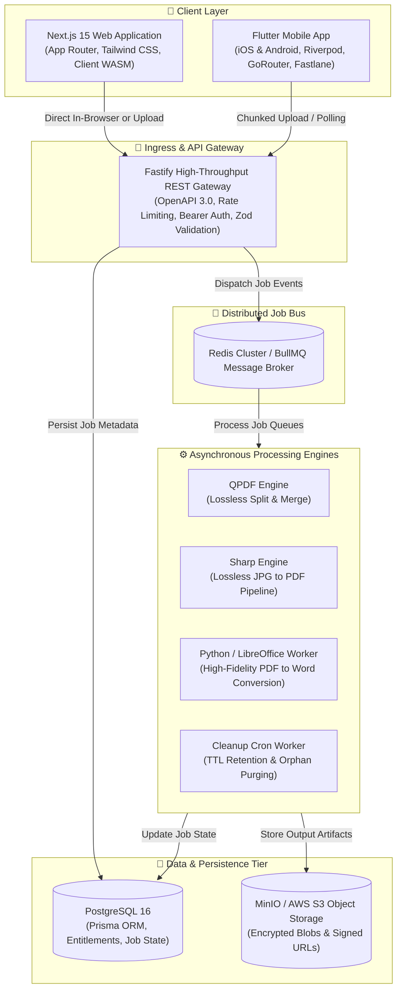
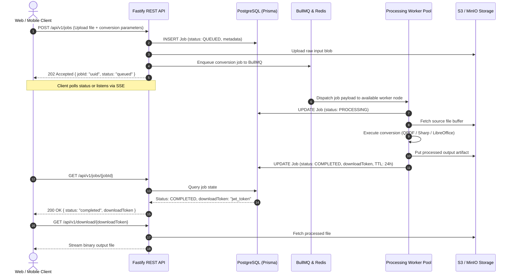
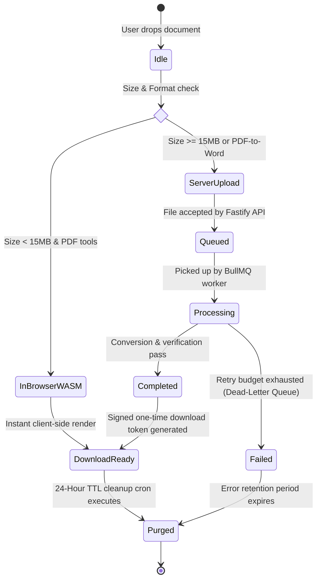

# 📄 PDF Suite: Enterprise Distributed Document SaaS Monorepo

> **PDF Suite** is an enterprise-grade, distributed document processing SaaS platform built as a high-performance monorepo. It features client-side WASM processing, high-throughput asynchronous job workers, cross-platform mobile support (iOS/Android), and complete database schema orchestration.

[]()
[-000000?logo=next.js)]()
[]()
[]()
[]()
[]()
[]()
[]()

---

## 🏛️ System Architecture Diagrams

### 1. High-Level Distributed Topology



---

### 2. End-to-End Asynchronous Job Lifecycle

This sequence diagram details how heavy conversions are orchestrated asynchronously across the Fastify gateway, BullMQ queue, distributed worker pool, and S3 object storage:



---

### 3. Document Lifecycle State Machine



---

## 📂 Monorepo Structure

```
money/
├── apps/
│   ├── web/                     # Next.js 15 (React 19) web application
│   │   ├── src/app/             # App router pages (Compress, Split, Merge, PDF-to-Word, JPG-to-PDF)
│   │   ├── src/components/      # Reusable upload dropzones, stage indicators, job pollers
│   │   └── src/lib/pdf/         # Client-side WASM processing engines with API fallbacks
│   └── mobile/                  # Flutter mobile client (iOS / Android)
│       ├── lib/core/            # Network interceptors, secure storage, SQLite queue, router
│       ├── lib/features/        # Domain, application, and presentation layers (Riverpod)
│       └── fastlane/            # Automated App Store & Play Store deployment pipelines
├── services/
│   ├── api/                     # Fastify 5.x REST API service
│   │   ├── src/routes/v1/       # Versioned API routes for PDF conversion, compression, streaming downloads
│   │   ├── src/plugins/         # Rate limiting, CORS, Bearer auth, multipart upload handlers
│   │   └── openapi.yaml         # Complete OpenAPI 3.0 specification
│   └── workers/                 # Distributed BullMQ processing workers
│       ├── src/workers/         # Compress, Split, Merge, PDF-to-Word, JPG-to-PDF, Cleanup
│       ├── src/processing/      # QPDF, Sharp, and Python LibreOffice bindings
│       └── docker/              # Multi-stage production container images
├── packages/
│   ├── pdf-core/                # Shared document manipulation primitives
│   └── shared-types/            # Canonical TypeScript contracts shared across Web & API
├── infra/
│   └── prisma/                  # Prisma schema, migrations, and database seed fixtures
├── turbo.json                   # Turborepo build pipeline configuration
└── pnpm-workspace.yaml          # Monorepo workspace boundaries
```

---

## ⚡ Key Features

1. **Dual Execution Engine (Client WASM + Cloud Workers)**:
   - Small files (<15 MB) can process directly in the client's browser using WebAssembly / `pdf-lib` for zero latency and zero server compute cost.
   - Heavy files and advanced conversions (e.g. PDF to Word using LibreOffice) are seamlessly dispatched to asynchronous worker queues via signed URLs.
2. **Institutional Grade Architecture**:
   - **Fault-Tolerant Worker Pipelines**: Powered by BullMQ with exponential backoff, dead-letter queues, and automatic cleanup.
   - **Enterprise Security**: Multipart chunk validation, rate-limiting plugins, tokenized one-time download URLs, and isolated ephemeral storage.
   - **Cross-Platform Parity**: Full feature parity between Next.js responsive web and Flutter native mobile applications.

---

## 🛠️ Quickstart

### Prerequisites
- Node.js >= 22.0.0
- pnpm >= 10.0.0
- Docker & Docker Compose

### 1. Install Dependencies
```bash
pnpm install
```

### 2. Configure Environment
```bash
cp .env.example .env
```

### 3. Start Infrastructure (PostgreSQL, Redis, MinIO)
```bash
docker compose -f services/workers/docker/docker-compose.dev.yml up -d
```

### 4. Push Database Schema
```bash
pnpm --filter infra db:push
```

### 5. Launch Full Monorepo in Development Mode
```bash
pnpm dev
```

---

## 📜 License
MIT © [Subhash](https://github.com/Subhash6102003)
